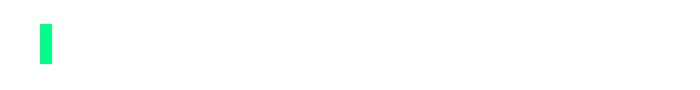
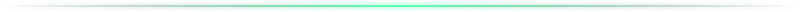
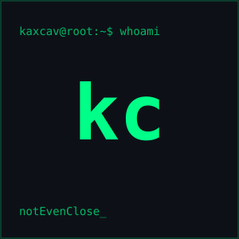

<!-- ═══════════════ HEADER ═══════════════ -->

  
   
  

<!-- ═══════════════ WHO AM I ═══════════════ -->
<h2 align="center">Who Am I?</h2>

<table>
  <tr>
    <td width="300" valign="top">
      
    </td>
    <td valign="top">
      

        Sou <b>notEvenClose</b>, <b>Especialista em Cybersecurity</b> e <b>Desenvolvedor Full Stack</b> focado em <b>segurança ofensiva</b> e <b>engenharia de sistemas modernos e escaláveis</b>. Trabalho em projetos próprios e como <b>freelancer</b>, entregando soluções completas, da <b>arquitetura</b> até a <b>interface final</b>.
      

      

        Tenho experiência com <b>Pentest, Exploit Dev, Malware Analysis e Red Team</b>, além de atuar com <b>APIs, automações e inteligência artificial</b>. Sempre priorizo desempenho, segurança e usabilidade, unindo <b>design e funcionalidade</b> com foco em <b>segurança desde a concepção</b>.
      

      

        Atualmente estou evoluindo em <b>AI Engineering</b>, <b>malware development</b> e <b>autonomous agents</b>, com foco em construir projetos sólidos e gerar impacto real no mercado de segurança.
      

    </td>
  </tr>
</table>

<!-- ═══════════════ CAUTION ═══════════════ -->
> [!CAUTION]
> Security by design, not by accident.

<!-- ═══════════════ TECH STACK ═══════════════ -->
<h2 align="center">Tech Stack</h2>

**Languages** 

**Frameworks** 

**Security Tools** 

**Infra** 

<!-- ═══════════════ FEATURED PROJECTS ═══════════════
  Preencha os nomes dos repositórios e remova os comentários.
  Cada card é uma tabela de 2 colunas.

<h2 align="center">Featured Projects</h2>

<table align="center">
  <tr>
    <td></td>
    <td></td>
  </tr>
  <tr>
    <td></td>
    <td></td>
  </tr>
</table>
-->

<h2 align="center">Featured Projects</h2>

<code>$ ls ./projects</code> Em breve. Confira os repositórios em <a href="https://github.com/kaxcav?tab=repositories">kaxcav</a>.

<!-- ═══════════════ GITHUB STATS ═══════════════ -->
<h2 align="center">GitHub Stats</h2>

  
  
   
  

 

<!-- ═══════════════ SNAKE ═══════════════
  Requer o workflow .github/workflows/snake.yml (branch "output") -->

  <picture>
    <source media="(prefers-color-scheme: dark)" srcset="https://raw.githubusercontent.com/kaxcav/kaxcav/output/github-snake-dark.svg" />
    <source media="(prefers-color-scheme: light)" srcset="https://raw.githubusercontent.com/kaxcav/kaxcav/output/github-snake.svg" />
    
  </picture>

<!-- ═══════════════ CONTACT ═══════════════ -->
<h2 align="center">Contact</h2>

  
  
  

<!-- ═══════════════ FOOTER ═══════════════ -->

